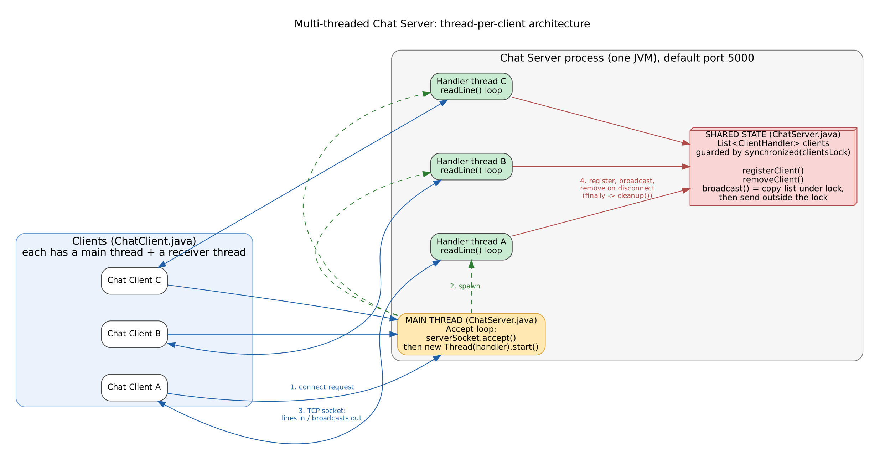
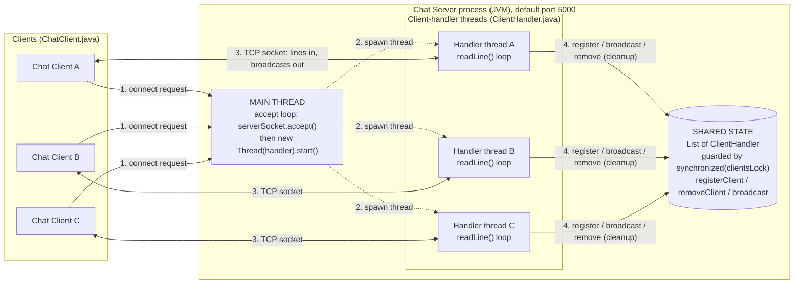
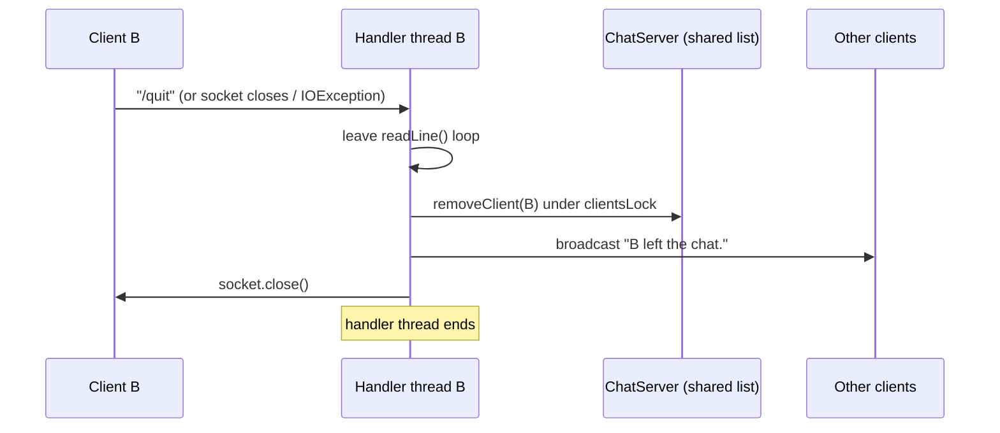

# Architecture

*Figure 1: Thread-per-client architecture. Vector version: [architecture.svg](architecture.svg). Graphviz source: [architecture.dot](architecture.dot).*

## Components

| Component | File | Runs on | Role |
|---|---|---|---|
| Chat Client | `src/ChatClient.java` | its own JVM; main thread + `receiver` thread | connects, sends typed lines, prints incoming lines |
| Chat Server (accept loop) | `src/ChatServer.java` | the server's **main thread** | `accept()` connections, start one handler thread each |
| Client handler | `src/ClientHandler.java` | **one thread per client** | read lines from its client, register / broadcast / clean up |
| Shared client list | `ChatServer.clients` + `clientsLock` | accessed by all handler threads | the set of connected clients, always accessed inside `synchronized (clientsLock)` |

## Message flow

1. **Connection request:** a client opens a TCP connection to the server port. The main thread's `accept()` returns a `Socket`.
2. **Spawn:** the main thread creates a `ClientHandler` for that socket, starts a new thread for it and returns to `accept()`.
3. **Chat traffic:** the same TCP connection carries lines from the client to its handler thread and broadcast text from the server back to the client (both directions).
4. **Shared state:** the handler registers its client in the shared list, and later broadcasts each received line and removes the client when it leaves (`finally` block, `cleanup()`).
5. **Broadcast:** `broadcast()` copies the list under the lock, then calls `sendMessage()` on every other client's handler, which writes to that client's socket.

## Mermaid source (editable, renders on GitHub)

## Disconnection sequence

## Note on accuracy

The diagram shows what the code does: one main thread, one handler thread per client, and one shared list guarded by one lock. A handler delivers a broadcast by calling `sendMessage()` on the other handlers directly; there is no separate "broadcaster" thread or message queue.
