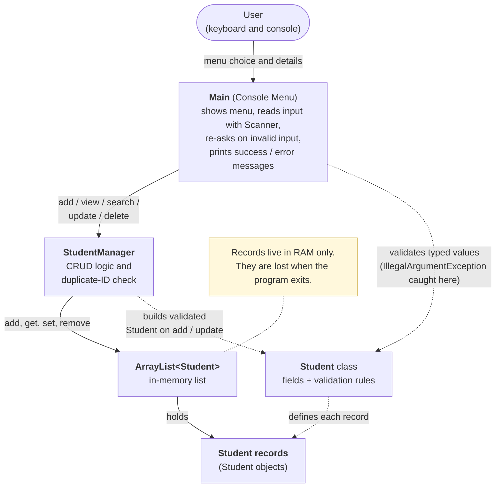

# Architecture – StudentCRUDConsoleApp

This is a **pure Java console application**. There is no database, no server, no REST API and no GUI.
All student records are kept in an `ArrayList<Student>` in memory and are lost when the program exits.

## 1. Flow diagram

Image versions for your internship report (generated from the same diagram source):

- `docs/architecture-diagram.png`
- `docs/architecture-diagram.svg`
- `docs/architecture-diagram.mmd` (the Mermaid source file)

> The main path is **User → Main → StudentManager → ArrayList&lt;Student&gt; → Student records** (solid arrows).
> Dotted arrows show where the `Student` class is used (it defines each record and holds the validation rules).

## 2. The components in simple terms

| Component | File | Plain-English job |
|---|---|---|
| **User** | – | The person typing at the keyboard. |
| **Main (Console Menu)** | `src/Main.java` | The "front desk". Shows the menu, reads what the user types (always a full line with `nextLine()`), asks again if a value is invalid, and prints `[SUCCESS]`, `[ERROR]` and `[INFO]` messages. It does not store students itself. |
| **StudentManager** | `src/StudentManager.java` | The "record keeper". Owns the list and performs Create, Read, Update and Delete. Rejects duplicate IDs and reports "not found" cleanly. |
| **ArrayList&lt;Student&gt;** | inside `StudentManager` | The in-memory storage. Keeps students in the order they were added. |
| **Student** | `src/Student.java` | One student record (ID, name, email, department, year) plus the validation rules for those values. |
| **Student records** | – | The `Student` objects sitting in the list while the program runs. |

## 3. Where validation and error handling happen

| Where | What it does |
|---|---|
| `Student` | Holds **all** validation rules (`validateName`, `validateEmail`, `validateDepartment`, `validateYear`, `parseId`, `parseYear`). Invalid data throws `IllegalArgumentException` with a clear message, so an invalid `Student` can never exist. |
| `StudentManager` | Prevents duplicate IDs (`addStudent` returns `false`), reports missing IDs (`find` returns `null`, `update` and `delete` return `false`), and builds a new validated `Student` on update so a bad value never leaves a half-updated record. |
| `Main` | Catches `IllegalArgumentException` at the input boundary, prints the message, and asks again. Invalid menu choices are rejected. A final safety `catch` prevents any stack trace from reaching the user. If the input stream ends (for example Ctrl+Z), the program exits cleanly. |

Because the rules live only in `Student`, **Add and Update are validated identically**.

## 4. Example: what happens when you add a student

1. `Main` shows the menu and reads `1`.
2. `Main` asks for an ID and calls `Student.parseId(...)`. Bad text → error message → asked again.
3. `Main` asks `StudentManager.idExists(id)`. If it exists → duplicate error → back to the menu.
4. `Main` collects name, email, department and year, each checked by the `Student.validate...` methods.
5. `Main` creates `new Student(...)` and passes it to `StudentManager.addStudent(...)`.
6. `StudentManager` adds it to the `ArrayList` and returns `true`; `Main` prints `[SUCCESS]`.
