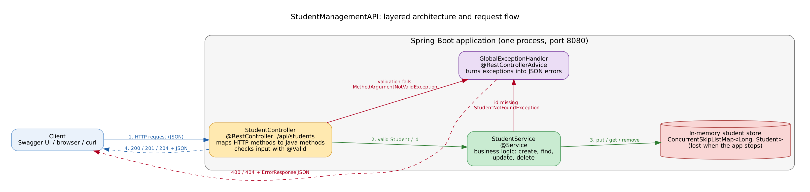

# StudentManagementAPI

A simple **Spring Boot REST API** for managing student records (create, read, update, delete) with validation, consistent error responses, interactive **Swagger/OpenAPI** documentation and automated tests.

NexLevr Java Development Internship, Task 2
Author: Nakshatra M, B.Tech. Information Technology (II Year), R.M.K. Engineering College

> **Status:** the source code and documentation are complete. The code was written in an environment that could not download Maven dependencies, so it has **not yet been compiled or run with Spring Boot by the author**. Run the steps below on your machine (`.\mvnw.cmd test`) to verify it. See [Testing](#testing).

## Objective

Demonstrate REST architecture, HTTP methods and status codes, JSON request/response handling, a layered Spring Boot structure, input validation, error handling, Swagger documentation and automated endpoint tests.

## Features

- CRUD endpoints for students under `/api/students`
- Correct status codes: `201`, `200`, `204`, `400`, `404`
- Bean Validation on the request body (blank name/email/department, email format, year 1-4)
- Server-generated unique ids (thread-safe)
- Global exception handler with one consistent JSON error format; no stack traces exposed
- Swagger UI and OpenAPI JSON generated from the controller annotations
- 22 automated MockMvc tests (independent of each other)

## Technologies

Java 17+ (compatible with JDK 17 and 21), Spring Boot 3.5.x, Spring Web, Spring Validation (Hibernate Validator), springdoc-openapi 2.8.x, JUnit 5 + MockMvc (Spring Boot Test), Maven.

## Architecture



Client / Swagger UI -> `StudentController` -> `StudentService` -> in-memory store, with `GlobalExceptionHandler` converting validation failures and missing records into JSON errors. Details and Mermaid diagrams: [docs/architecture.md](docs/architecture.md).

## Project structure

```
StudentManagementAPI/
├── pom.xml
├── mvnw, mvnw.cmd, .mvn/            Maven wrapper (see "Add the Maven wrapper")
├── .gitignore
├── README.md
├── src/main/java/com/nakshatra/studentmanagementapi/
│   ├── StudentManagementApiApplication.java
│   ├── controller/StudentController.java
│   ├── service/StudentService.java
│   ├── model/Student.java
│   ├── exception/StudentNotFoundException.java
│   ├── exception/GlobalExceptionHandler.java
│   ├── exception/ErrorResponse.java        (added: shared error JSON shape)
│   └── config/OpenApiConfig.java           (added: Swagger title/description)
├── src/main/resources/application.properties
├── src/test/java/com/nakshatra/studentmanagementapi/StudentControllerTest.java
├── docs/   architecture.md, architecture.png/.svg/.dot, api-testing.md, linkedin-post.md
└── screenshots/README.md                  (checklist; add your own images)
```

The only differences from the suggested structure are the two added files marked above.

## Prerequisites

- JDK **17 or newer** (`java -version`)
- VS Code (the "Extension Pack for Java" is helpful but not required)
- Internet access for the first build (dependencies are downloaded)
- Git, for publishing

## Add the Maven wrapper (one-time step)

The wrapper files (`mvnw`, `mvnw.cmd`, `.mvn/`) were **not** generated here because Maven Central and start.spring.io were not reachable. Generate them once:

**Option A (recommended): Spring Initializr**
1. Open <https://start.spring.io>.
2. Choose: Project **Maven**, Language **Java**, Spring Boot the latest **3.5.x** release (not 4.x, not SNAPSHOT), Group `com.nakshatra`, Artifact `studentmanagementapi`, Name `StudentManagementAPI`, Packaging **Jar**, Java **17** (or 21).
3. Add dependencies **Spring Web** and **Validation**. Click **Generate** and unzip the download.
4. From the unzipped folder copy **`mvnw`, `mvnw.cmd` and the `.mvn` folder** into this project's root next to `pom.xml`. Do **not** copy its `pom.xml` or source files; keep this project's.

**Option B: if Maven is already installed:** in the project root run `mvn -N wrapper:wrapper`.

Check:

```powershell
Get-ChildItem pom.xml, mvnw.cmd, .mvn\wrapper
```

## Installation and execution (VS Code, Windows PowerShell)

1. In VS Code: `File > Open Folder...` and choose the `StudentManagementAPI` folder.
2. Open a terminal: ``Ctrl+` ``.
3. Run:

```powershell
.\mvnw.cmd spring-boot:run
```

4. Wait for `Started StudentManagementApiApplication`. The API is now at `http://localhost:8080`.
5. Stop with `Ctrl+C` (answer `Y` if asked "Terminate batch job").

Port 8080 busy? Set `server.port=8081` in `src/main/resources/application.properties` and use 8081 in all URLs.

## Swagger / OpenAPI

| What | URL (local only) |
|---|---|
| Swagger UI | <http://localhost:8080/swagger-ui/index.html> |
| OpenAPI JSON | <http://localhost:8080/v3/api-docs> |

These work only while the application runs on your computer. The project is **not deployed**, so there is no public Swagger URL.

## Endpoints

| Method | Endpoint | Purpose | Success | Errors |
|---|---|---|---|---|
| POST | `/api/students` | Create a student | `201 Created` (+ `Location` header) | `400` |
| GET | `/api/students` | List all students | `200 OK` (empty list if none) | |
| GET | `/api/students/{id}` | Get one student | `200 OK` | `400` (id not a number), `404` |
| PUT | `/api/students/{id}` | Replace an existing student | `200 OK` | `400`, `404` |
| DELETE | `/api/students/{id}` | Delete a student | `204 No Content` | `400`, `404` |

### Validation rules

| Field | Rule |
|---|---|
| `id` | Generated by the server; any value sent by the client is ignored |
| `name` | Required, not blank, max 100 characters |
| `email` | Required, not blank, valid email format, max 254 characters |
| `department` | Required, not blank, max 100 characters |
| `year` | Required, whole number 1 to 4 |

The year range 1-4 matches a B.Tech programme; change `@Min`/`@Max` in `Student.java` if you need another range. Note that the standard `@Email` check accepts some unusual addresses such as `a@b` (no dot); it rejects obvious errors like `not-an-email`.

### Sample requests and responses (sample data; illustrative, not captured from a run)

Create:

```
POST /api/students
{"name":"Nakshatra M","email":"nakshatra@example.com","department":"Information Technology","year":2}

201 Created
Location: http://localhost:8080/api/students/1
{"id":1,"name":"Nakshatra M","email":"nakshatra@example.com","department":"Information Technology","year":2}
```

Validation error:

```
POST /api/students
{"name":"","email":"not-an-email","department":"Information Technology","year":0}

400 Bad Request
{"timestamp":"2026-10-11T09:45:00.123Z","status":400,"error":"Bad Request","message":"Validation failed",
 "fieldErrors":{"name":"Name must not be blank","email":"Email must be a valid email address","year":"Year must be between 1 and 4"}}
```

Not found:

```
GET /api/students/99

404 Not Found
{"timestamp":"2026-10-11T09:45:00.123Z","status":404,"error":"Not Found","message":"Student with id 99 was not found"}
```

Full step-by-step demonstration: [docs/api-testing.md](docs/api-testing.md).

## Testing

```powershell
.\mvnw.cmd test
```

`StudentControllerTest` contains 22 tests that call the API through MockMvc: create (valid, client-supplied id ignored, unique ids), list (with data and empty), get by id (existing, missing, non-numeric, negative), update (existing, missing, invalid data), delete (existing, missing, non-numeric), invalid input (bad fields, missing fields, year out of range, malformed JSON, wrong type, no body) and the OpenAPI document. Each test resets the in-memory store first, so the order does not matter.

**Verification status (honest summary):**
- Expected result on your machine: `Tests run: 22, Failures: 0, Errors: 0` and `BUILD SUCCESS`. This has **not yet been observed** with real Spring Boot.
- What *was* checked in the authoring environment: the main source files compile against minimal stand-in stubs of the Spring/Swagger annotations (syntax and wiring only), and the service logic (create, find, update, delete, unique ids under 4,000 concurrent creates) ran correctly. This does not replace your own `.\mvnw.cmd test`.

## Limitations

- **In-memory storage:** all students are lost whenever the application stops or restarts. There is no database.
- No authentication or authorization; anyone who can reach the port can change data.
- No pagination, search or duplicate-email check.
- Not deployed; Swagger runs on localhost only. This is a learning project, not production software.

## Future improvements

Add a database (Spring Data JPA with H2 or PostgreSQL), unique email constraint (`409 Conflict`), pagination and search, Spring Security, Docker, and deployment with a public Swagger URL.

## Screenshots

Take your own screenshots and place them in `screenshots/` (checklist: [screenshots/README.md](screenshots/README.md)).

| Screenshot | Placeholder file |
|---|---|
| Application running | `screenshots/01-app-running-terminal.png` |
| Swagger UI with all endpoints | `screenshots/02-swagger-ui-all-endpoints.png` |
| Student created (201) | `screenshots/03-create-student-201.png` |
| Validation error (400) | `screenshots/07-validation-error-400.png` |
| Automated tests | `screenshots/08-automated-tests-output.png` |

## Preparing the GitHub repository

```powershell
git init
git add .
git status          # check that target/ and .vscode/ are NOT listed, and that mvnw.cmd and .mvn/ ARE
git commit -m "Add Student Management REST API"
git branch -M main
# Create an EMPTY repository on github.com first (no README/.gitignore), then paste your own URL:
git remote add origin https://github.com/<your-username>/StudentManagementAPI.git
git push -u origin main
```

If this is your first commit, set your identity once: `git config --global user.name "Your Name"` and `git config --global user.email "you@example.com"`. Sign in through the browser prompt when Git asks, or use a personal access token; never store tokens in project files. Add your real repository link to the LinkedIn draft in [docs/linkedin-post.md](docs/linkedin-post.md) only after the push succeeds.

## License / Use

Created for educational purposes during the NexLevr internship.
