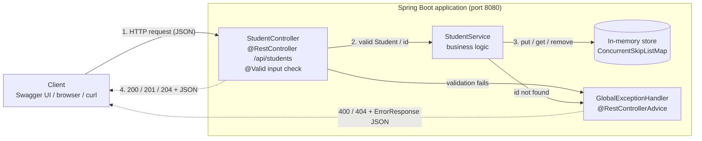
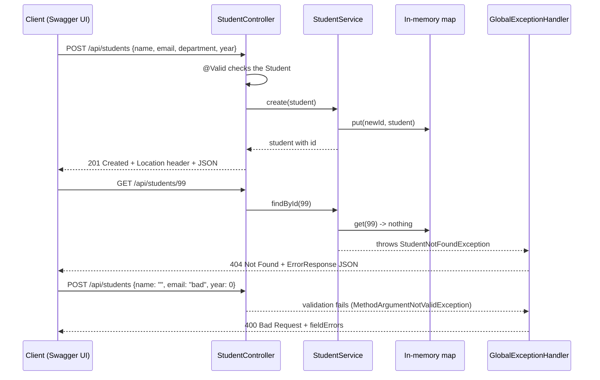

# Architecture

*Figure 1: Layered architecture and request flow. Vector version: [architecture.svg](architecture.svg). Graphviz source: [architecture.dot](architecture.dot).*

The application has **no database**. Students are kept in a map in memory, so the diagram shows none.

## Components in simple terms

| Component | Class / file | What it does |
|---|---|---|
| Client | Swagger UI, a browser, `curl`, PowerShell | Sends HTTP requests and shows the responses. |
| Controller | `controller/StudentController.java` | The "front desk". Receives the HTTP request, checks the JSON body with `@Valid`, asks the service to do the work and returns the HTTP status and JSON. No business logic here. |
| Service | `service/StudentService.java` | The "brain". Creates ids, adds, finds, replaces and removes students. Throws `StudentNotFoundException` when an id does not exist. |
| Model | `model/Student.java` | The data (`id`, `name`, `email`, `department`, `year`) plus the validation rules as annotations. |
| In-memory store | `ConcurrentSkipListMap<Long, Student>` inside the service | Holds the records while the app runs. A thread-safe map sorted by id. Lost on restart. |
| Exception handler | `exception/GlobalExceptionHandler.java` | Catches exceptions and converts them to a consistent JSON `ErrorResponse` (400 or 404). |
| Error shape | `exception/ErrorResponse.java` | The one JSON format used for every error. |
| OpenAPI config | `config/OpenApiConfig.java` + springdoc | Generates `/v3/api-docs` and Swagger UI from the controller annotations. |

## Request flow (success path)

1. The client sends an HTTP request, for example `POST /api/students` with a JSON body.
2. Spring converts the JSON into a `Student` object and runs the validation rules (`@Valid`).
3. `StudentController` calls the matching method on `StudentService`.
4. `StudentService` reads or changes the in-memory map and returns the result.
5. The controller wraps it in a `ResponseEntity` (`201`, `200` or `204`) and Spring writes the JSON response.

## Validation and error path

- **Invalid body** (blank name, bad email, year outside 1-4, missing fields): Spring throws `MethodArgumentNotValidException` *before* the controller method runs. `GlobalExceptionHandler` returns **400** with a `fieldErrors` map.
- **Malformed JSON, missing body, wrong field type**: `HttpMessageNotReadableException` -> **400**.
- **Non-numeric id** such as `/api/students/abc`: `MethodArgumentTypeMismatchException` -> **400**.
- **Unknown id**: the service throws `StudentNotFoundException` -> **404**.

No stack traces or internal class names are sent to the client.

## Mermaid version (renders on GitHub)

## Sequence diagram: create, then request a missing student

## Why this structure

The task suggested `controller`, `service`, `model` and `exception` packages, and these are used as described. Two small additions: `exception/ErrorResponse.java` (the shared error JSON) and `config/OpenApiConfig.java` (Swagger title and description). Keeping HTTP handling, business logic and data separate means each can be changed without touching the others, for example swapping the map for a database later only changes `StudentService`.
